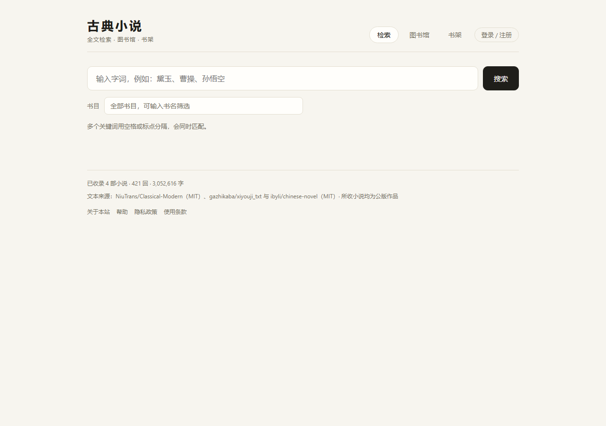
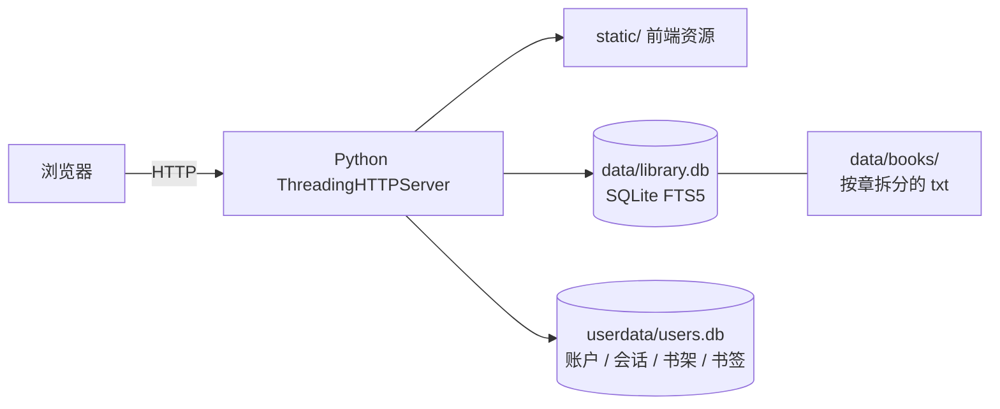
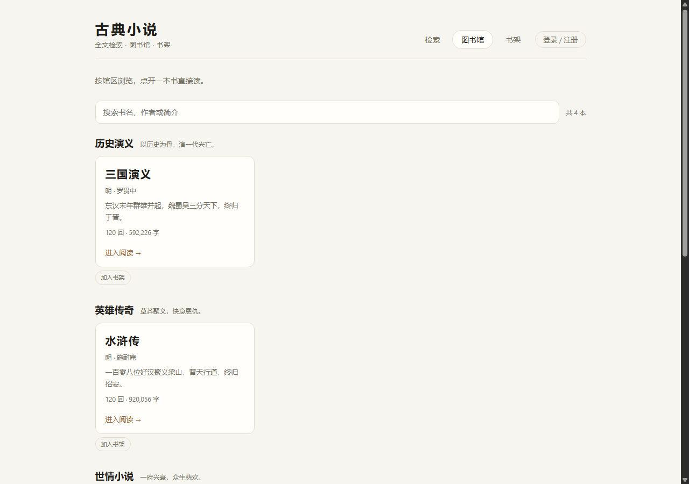
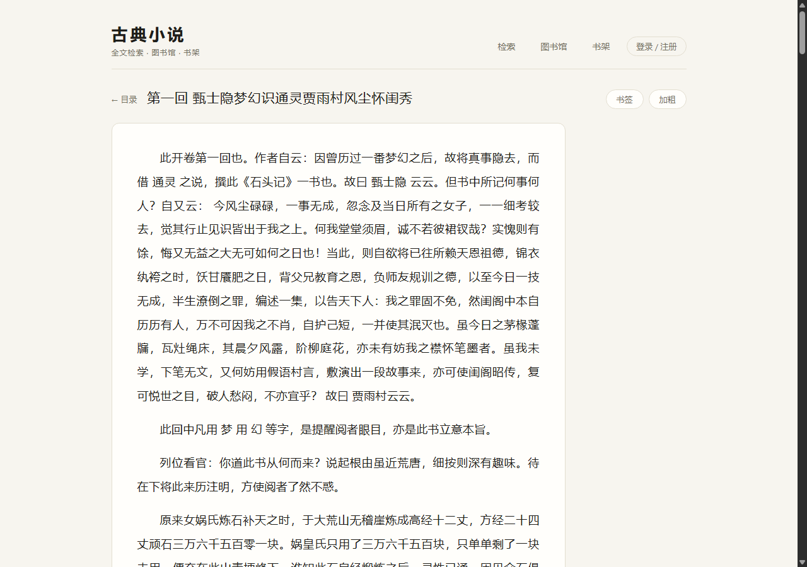

# 古典小说全文检索 · Novel Search

一个面向中国古典小说与海外公版小说的全文检索、在线阅读站点。支持按关键词定位原文章节、按馆区浏览书目、在线阅读、书架与书签，以及带恢复码的账户体系。

**线上演示：<https://yjwops.com>**



## 功能

- **全文检索**：基于 SQLite FTS5，中文按单字索引、英文按单词索引；支持空格或中英文标点切词，例如 `黛玉，宝玉`。
- **结果定位**：结果按书分组，展示命中片段与高亮，可直接跳到对应章节段落。
- **图书馆**：按历史演义、英雄传奇、神魔小说、世情小说、讽刺谴责、海外名著分类浏览；默认一行 3 本，展开后 4 本。
- **在线阅读**：章节目录、上下章切换、正文加粗、移动端底部翻页。
- **书架与书签**：游客数据保存在浏览器；登录后同步到账户，首次登录会合并游客数据。
- **账户体系**：用户名 + 密码 + 恢复码，不收集手机号或邮箱；scrypt 加盐哈希、HttpOnly + SameSite 会话 Cookie、登录/注册频率限制。
- **检索友好**：书名、作者、简介可搜索；图书馆页也支持按书名、作者或简介过滤。

## 技术栈

- Python 3（标准库 `ThreadingHTTPServer`，无 Web 框架）
- SQLite + FTS5 全文索引
- 原生 JavaScript / CSS，无前端构建步骤
- Docker / Docker Compose
- Nginx 反向代理（示例配置见 `deploy/nginx.conf.example`）

## 架构



- `data/books/<书名>/001.txt` 是唯一文本源，启动时若索引缺失或文本更新会自动重建 `library.db`。
- `users.db` 独立存放，重建全文索引不会影响账户、书架和书签。

## 快速开始

要求 Python 3.10+。

```bash
python server.py 8000
```

启动后访问 <http://localhost:8000>。首次启动会自动根据 `data/books` 构建全文索引。

也可以使用 Docker：

```bash
docker compose up -d --build
```

默认监听 `8000` 端口，账户数据保存在 `userdata` 命名卷中。

## 示例数据

本展示仓库只包含 4 部公版示例书，用于演示完整功能：

- 《三国演义》120 章
- 《水浒传》120 章
- 《红楼梦》120 章
- 《傲慢与偏见》（英文原版）61 章

线上站点收录 130 部、9,901 章、约 6,000 万字。完整书库未放入本仓库，避免仓库过大；可通过 `fetch_books.py`、`fetch_extra_books.py`、`fetch_overseas_books.py` 重新抓取。



## 项目结构

```text
.
├── server.py              # HTTP 服务与 API
├── library.py             # FTS5 索引、检索、书目与章节
├── accounts.py            # 账户、会话、书架、书签
├── backup_users_db.py     # 账户库在线备份
├── fetch_books.py         # 初始书目抓取
├── fetch_extra_books.py   # 补充章回小说
├── fetch_overseas_books.py# 古腾堡海外公版小说
├── static/                # 原生前端
├── data/books/            # 按章拆分的文本
├── data/overseas_books.json
├── deploy/nginx.conf.example
├── Dockerfile
└── docker-compose.yml
```

## 实现要点

- **中文检索**：把正文拆成单字 token，英文按单词并统一小写，写入 FTS5；查询使用短语匹配，兼顾准确性与召回。
- **标点切词**：前端和后端共用标点分隔规则，避免从正文复制带标点的句子时“查不到”。
- **摘要与高亮**：按句号、问号、感叹号等截取命中句，返回相对偏移量供前端高亮。
- **账户安全**：密码与恢复码使用 `scrypt` 加盐哈希；会话 token 只保存 SHA-256 哈希；Cookie 设置 HttpOnly、SameSite=Lax。
- **数据分离**：`library.db` 是可重建的索引，`users.db` 独立持久化，避免重建索引时丢账户数据。



## 数据来源与许可

- 《三国演义》《水浒传》《红楼梦》等文本来自 NiuTrans/Classical-Modern（MIT）等公开项目。
- 《傲慢与偏见》来自 Project Gutenberg（公有领域）。
- 完整来源、许可与公版说明见 [THIRD_PARTY_NOTICES.txt](THIRD_PARTY_NOTICES.txt) 与 `licenses/`。

本仓库代码用于个人作品展示，未声明开源许可证；如需复用请先联系作者。文本均为公版作品，整理与校对版权归原项目所有。
